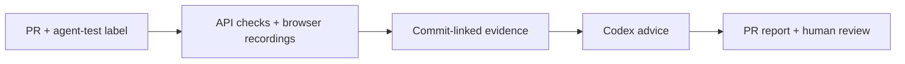

# Exhibit: hackathon review guide

Built for the **DevDay Exchange Community Metro Hackathon Pune**, **24 October 2026**.
Theme: **Developer Tools**.

## Project in 30 seconds

**Problem:** AI-assisted development produces changes that maintainers still need to
review. A green test badge and a code diff leave behavioral context spread across
logs, browser sessions and separate tools.

**Solution:** Exhibit puts recorded frontend behavior, deterministic backend results,
the exact tested commit, and explicit coverage gaps into a reviewable evidence bundle.
Codex helps interpret the results and suggest additional checks. The reviewer keeps
the decision; agent commentary cannot change a test result or issue a trusted verdict.



**Demonstrated user:** a maintainer reviewing a checkout change. Adding `agent-test`
to an eligible sample PR starts recorded tests and returns a report to the PR, including
express-delivery pricing, rejection paths and scoped cleanup. The workspace also offers
a playable, downloadable sample evidence explorer without staging credentials.

## Three-minute walkthrough

With the app already running, choose **Explore sample workspace**. No database or
Codex account is needed to inspect the bundled gallery.

| Time      | Action                                                                                                                                     | Observable result                                                                                                                                                                                                                                                                        |
| --------- | ------------------------------------------------------------------------------------------------------------------------------------------ | ---------------------------------------------------------------------------------------------------------------------------------------------------------------------------------------------------------------------------------------------------------------------------------------- |
| 0:00–0:45 | Open **Agent recordings → Evidence explorer** (`#/evidence/sample-project`). Play checkout, then payment declined.                         | Original recordings play; slow playback and frame stepping let the reviewer inspect behavior. The page labels the sample and unverified provenance.                                                                                                                                      |
| 0:45–1:15 | Select **API**, or **API / cURL evidence** in the sidebar. Open **Reject declined payment**.                                               | Actual command, response and expected HTTP 402 are visible. Download the original response; a negative scenario can be a passing assertion.                                                                                                                                              |
| 1:15–1:45 | Open **Artifacts** and **Provenance**.                                                                                                     | Full source SHA, original file hashes, downloads and both workflow attempts are inspectable. A failed earlier workflow remains visible after a successful retry.                                                                                                                         |
| 1:45–3:00 | Open the [completed PR comment](https://github.com/justafolk/sample-project-exhibit/pull/2#issuecomment-6383233364) and expand its report. | A newer sample CI run shows 4 frontend checks, 9 backend checks, recording previews, original artifact links and advisory Codex suggestions. The [start comment](https://github.com/justafolk/sample-project-exhibit/pull/2#issuecomment-6383212394) demonstrates the automatic handoff. |

GitHub proof links require access to the private repository. The bundled dashboard
recordings and API responses remain available from a prepared local checkout when
GitHub access or event connectivity is unavailable. The bundled snapshot and newer
PR run are different captures; their counts and source commits must be read separately.

For a fresh checkout, prerequisites and install time are additional to the walkthrough:

```sh
make bootstrap
make dev
```

Use the URL printed by Vite. See [development setup](development.md) for Node/Go
versions and browser dependencies. No cloud deployment is required for this demo.

## Judging criteria: where the evidence is

This map uses the event's two evaluation matrices. It identifies material to inspect;
it does not assign scores or claim outcomes that require a judge's assessment.

| Criterion                            | Concrete aspect to inspect                                                                                                                                                              | Source and evidence                                                                                                                                                                                                                                                                                                                             |
| ------------------------------------ | --------------------------------------------------------------------------------------------------------------------------------------------------------------------------------------- | ----------------------------------------------------------------------------------------------------------------------------------------------------------------------------------------------------------------------------------------------------------------------------------------------------------------------------------------------- |
| Matrix 1 · Technical Implementation  | React/TypeScript client, Go HTTP API, PostgreSQL metadata, generated OpenAPI types, explicit migrations and isolated CI stages.                                                         | [Architecture](architecture.md), [API](../services/api/), [contracts](../packages/contracts/), [CI](../.github/workflows/ci.yml). `make check` checks generated contracts, types/build, formatting, Go vet/race tests and tooling tests.                                                                                                        |
| Matrix 1 · Innovation & Creativity   | A change is reviewed through its observed behavior and API assertions, with commit/attempt identity and unknowns preserved. Codex adds coverage suggestions to the same review loop.    | [PR report](https://github.com/justafolk/sample-project-exhibit/pull/2#issuecomment-6383233364), [collector](../scripts/pr_evidence.py), [report generator](../scripts/codex_ci_report.py). The contribution is this combined review workflow; no first-of-its-kind claim is made.                                                              |
| Matrix 1 · Sponsor / Track Fit       | A developer tool built with Codex, with a real Codex CLI integration for advisory evidence review.                                                                                      | [Codex action](../.github/actions/codex-evidence-review/action.yml), [CLI runner](../scripts/codex_evidence_review.py), [agent handoff](../apps/web/src/pages/AgentSetup.tsx). Browser/API checks are deterministic; the agent does not drive the browser.                                                                                      |
| Matrix 1 · Execution & Completeness  | The sample loop runs from PR label through start notification, tests, recordings, reports and an owner-authored completion comment.                                                     | [Successful workflow](https://github.com/justafolk/sample-project-exhibit/actions/runs/40086787874), [sample PR #2](https://github.com/justafolk/sample-project-exhibit/pull/2), [publisher](../scripts/pr_evidence_comment.py). Completion applies to this bounded sample, not general customer orchestration.                                 |
| Matrix 2 · Functionality & Execution | Checkout totals, delivery pricing, validation, rejected payments/stock, retry behavior and cleanup have executable tests and original captures.                                         | [Sample API tests](https://github.com/justafolk/sample-project-exhibit/blob/71005c6cd5cb62837a2417ef8711ea6f6c6f6ebc/tests/storefront.test.js), [browser flows](https://github.com/justafolk/sample-project-exhibit/blob/71005c6cd5cb62837a2417ef8711ea6f6c6f6ebc/tests/browser/checkout.spec.js), [API collector](../scripts/api_evidence.py). |
| Matrix 2 · UI & UX Polish            | Review-first navigation, playable evidence, original downloads, URL-preserved filters, mobile navigation and actionable media/error states.                                             | [Evidence explorer](../apps/web/src/components/SampleEvidence.tsx), [API explorer](../apps/web/src/components/APIEvidence.tsx), [review queue](../apps/web/src/pages/Overview.tsx), [browser UX tests](../tests/e2e/sample-evidence.spec.ts). Follow the walkthrough to assess the actual experience.                                           |
| Matrix 2 · Solution Feasibility      | Uses existing repository tests and GitHub runners; the inspectable demo needs no database or customer credentials. Runtime/authentication boundaries and staged rollout are documented. | [Developer setup](development.md), [security](security.md), [execution policy](../agents/policies/execution.md), [product scope](product.md). Reviewer-time savings, adoption and production run costs remain unmeasured.                                                                                                                       |
| Matrix 2 · Innovation & Creativity   | Agent-produced evidence is separated from deterministic outcomes and human review; original media and failed attempts remain inspectable.                                               | [Evidence tooling](../agents/evidence-tooling.md), [sample source integrity](dashboard-evidence.md), [agent experience](agent-experience.md). Existing test/recording products are acknowledged in the research; the demo shows Exhibit's chosen integration.                                                                                   |
| Matrix 2 · Live Demonstration & Q&A  | One reproducible story: find a change, inspect browser behavior and API outcomes, confirm the commit, then read Codex's suggestions and the PR handoff.                                 | The walkthrough above and [Q&A notes](#qa-notes). Presentation quality and answers are for the live session to demonstrate.                                                                                                                                                                                                                     |

## Recorded end-to-end evidence

The following is an observed CI snapshot, not a claim that every future commit passes.
The PR comment updates on reruns; the listed workflow attempt and commit identify this snapshot:

| Field               | Observed value                                                                                                                                    |
| ------------------- | ------------------------------------------------------------------------------------------------------------------------------------------------- |
| Repository / PR     | `justafolk/sample-project-exhibit` · [PR #2](https://github.com/justafolk/sample-project-exhibit/pull/2)                                          |
| Tested commit       | `71005c6cd5cb62837a2417ef8711ea6f6c6f6ebc`                                                                                                        |
| Workflow / attempt  | [40086787874 · attempt 1](https://github.com/justafolk/sample-project-exhibit/actions/runs/40086787874)                                           |
| Frontend results    | 4 passed browser checks and 4 original 1280×720 recordings                                                                                        |
| Backend results     | 9 passed HTTP/API tests, with JUnit and clean-start provenance                                                                                    |
| Codex               | Authenticated CLI review completed; advice remains separate from assertions                                                                       |
| PR delivery         | Start comment preceded evidence tests; final comment followed Codex. Both were verified as authored by `justafolk`.                               |
| Report              | [HTML, Markdown and JSON bundle](https://github.com/justafolk/sample-project-exhibit/actions/runs/40086787874/artifacts/12557681341)              |
| Original artifacts  | [Videos, traces, screenshots and API results](https://github.com/justafolk/sample-project-exhibit/actions/runs/40086787874/artifacts/12556873542) |
| Verification status | **Sample / Unverified**. SHA-256 checks establish local byte consistency, not independent execution identity or redaction.                        |

The dashboard's bundled gallery is an older, separately documented capture: three
browser recordings at `c6865b266b8799b96bdbcb39b586982e51f9bf6a`, plus an explicitly
separate 11-request local cURL supplement. See [its provenance](dashboard-evidence.md).
It is not live ingestion of PR #2. CI artifacts have seven-day retention; preview
GIFs and committed gallery samples have their separately documented storage policies.
For new code, use a new run and inspect its own head SHA and results.

## Current boundaries

- The demonstrated Actions integration is intentionally scoped to the named sample
  repository and same-repository, non-draft PRs. The general GitHub App, durable
  scheduler and customer staging runner are not implemented.
- The dashboard serves curated recorded samples. Authenticated live ingestion,
  private expiring customer media delivery and independent trusted verification
  remain future work.
- Codex reviews test assertions and recording metadata. It does not watch video
  contents, operate the browser, fix production code or set a successful verdict.
- PR comments embed GIF previews with full-resolution video links. GitHub's API
  renderer does not support a native video-player embed in this integration.
- Private deployment needs database/account provisioning. Sample exploration is
  credential-free; live Codex review and owner-authored comments need the documented
  GitHub secrets. No credential belongs in this guide or a submission screenshot.
- No customer adoption, measured reviewer-time reduction, production SLA or price
  advantage is claimed. These are next validation questions, not completed results.

## Q&A notes

**Why use this alongside CI?** It brings behavioral recordings, API results, source
identity and coverage gaps into one review surface. Tests still determine their own
outcomes; maintainers can inspect the observed behavior and unknowns.

**Where does Codex add value?** Codex helped develop the prototype and the CI CLI
reviews recorded result metadata to suggest gaps, such as concurrent retries and
interrupted requests. The exact advice is visible in the linked report. Suggestions
are not executed tests or verified findings.

**What proves this works?** The linked run, original artifacts, individual test
results, hash checks, and account-verified comments can be inspected. The bundled
gallery also provides a reproducible local review experience. Neither is a guarantee
of bug-free code or complete coverage.

**What is the practical next step?** Validate the workflow with one real team's
approved test environment, then add scoped ingestion and private artifact delivery.
Measure review effort and run cost before making productivity or pricing claims.
